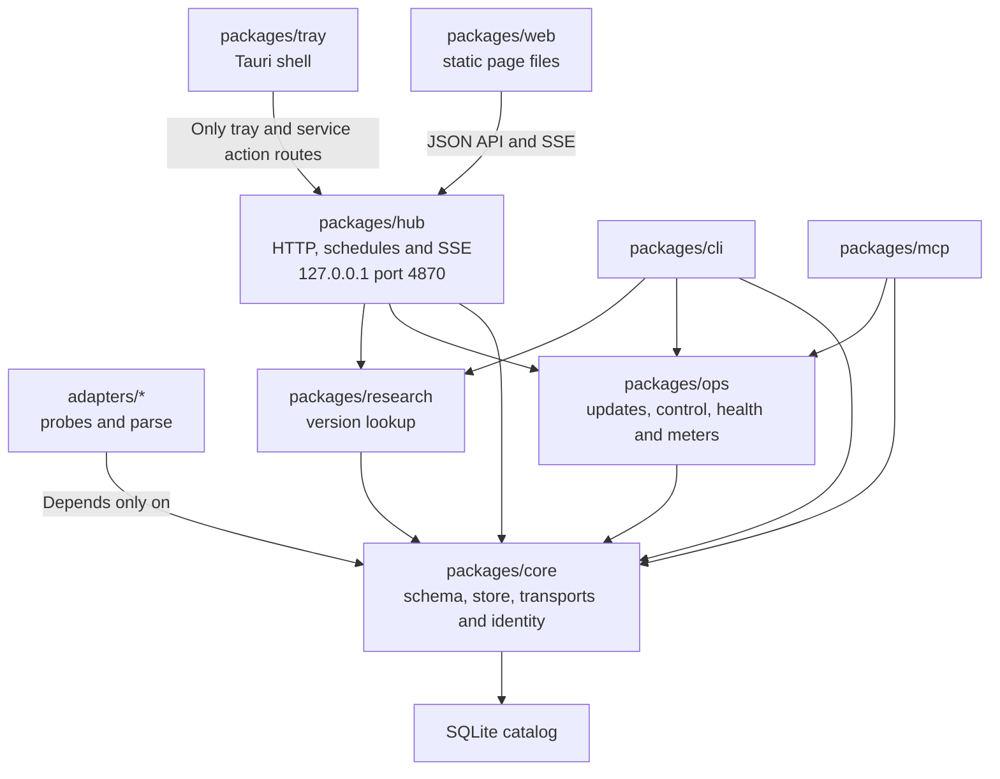
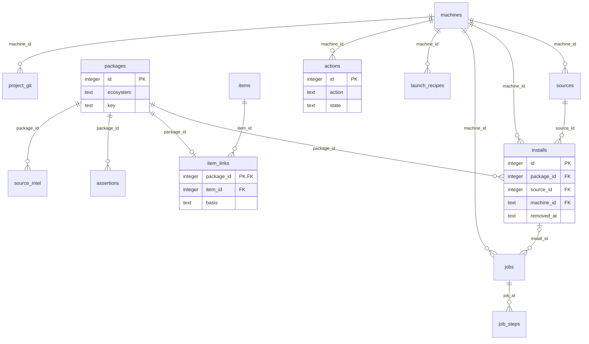
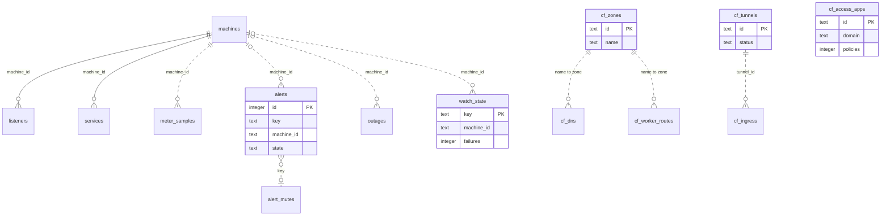
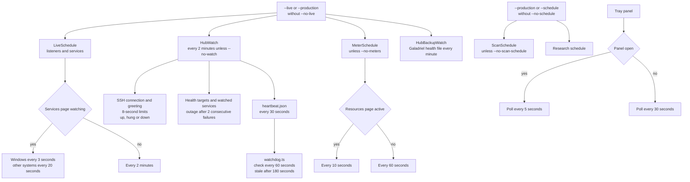
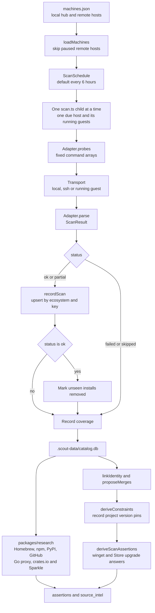
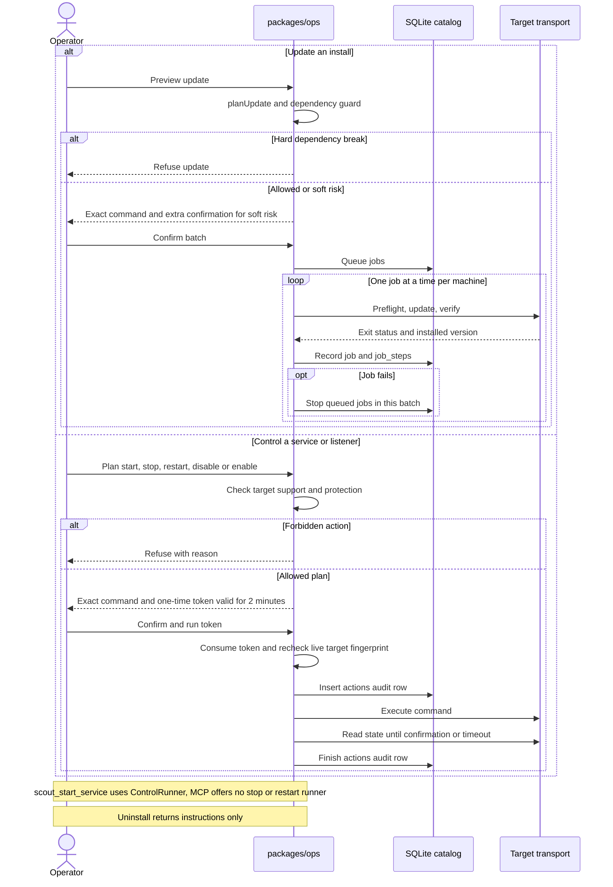

# Scout architecture

Scout is a pnpm workspace of TypeScript packages that Node 24 runs directly, with no build step. `pnpm test` runs `node --test` in every package and `pnpm typecheck` runs `tsc` over the workspace. Code rules are in [CONVENTIONS.md](../CONVENTIONS.md).

## Cogitator models

`adapters/cogitator-models` inventories engine paths and media folders from Cogitator's standard data directory on each host. The probes emit selected config fields, optional lock and catalog records, sidecars, and file metadata. They omit peer settings and key paths, never read secret files, never hash weights, and read only the GGUF header from a model file. Traversal stops at depth 4, 2000 files, or 20 seconds; incomplete output becomes a partial scan.

The Hugging Face researcher stores revision assertions and source intel with a 24-hour cache. It queries repository metadata, quantizations, fine-tunes, and the publisher's family matches in sequence, at least 250 ms apart. Successor candidates include the rule that identified them and remain possible successors. Scout never downloads or changes model weights.

## Packages

*Source of truth: `docs/ARCHITECTURE.md` and each package's `package.json`. The tray restricts its requests in `packages/tray/src-tauri/src/hub.rs`.*

| Package | Holds |
| --- | --- |
| `packages/core` | Catalog schema and SQLite store (`node:sqlite`), the adapter contract, transports, identity rules, and the query layers the CLI and hub share. |
| `packages/ops` | Everything that acts: update planner and runner, dependency guard, service control, Cloudflare reader, health probes, secret lookup. |
| `packages/research` | Version sources and the runner that caches their answers. |
| `packages/hub` | HTTP server, schedules, event stream, Cloudflare Access verification. |
| `packages/cli` | `scan`, `report`, `list`, `research`, `enrich`, and the `main.ts` commands. |
| `packages/web` | The page as static files in `public/`, with no framework. `dev/mock-hub.ts` serves it against a mock API. |
| `adapters/*` | One package per source, each depending only on `@scout/core`. |

## Adapters and fixtures

An adapter never touches a machine. `probes(ctx, location)` returns the fixed commands for one source as argument arrays, never shell strings, and nothing in them comes from user or page input. `parse(outputs, location)` is a pure function from the recorded output of those commands to a `ScanResult`. The transport runs the probes as local processes, over ssh under `zsh -lc`, or through a running guest's CLI, and hands back exit codes and output.

`parse` never throws: bad output becomes `partial` or `failed` with a message, and a missing tool is `skipped`. Each install is identified by `(ecosystem, key)`, such as `("winget", "Git.Git")`. Adapters report versions as the source prints them and never merge across ecosystems.

Each adapter is tested against `fixtures/<sourceKind>/<case>/`, where `outputs.json` is probe output recorded from a real machine and `expected.json` is the exact parse. `tools/record-pwsh.mjs` and `tools/record-mac.mjs` record cases, and `tools/redact-fixtures.mjs` strips usernames. A new platform starts here: pacman, systemd, and `ss` adapters for Arch Linux would follow the shape of `adapters/services` and `adapters/listeners`.

## Local git clones

The gitclone adapter lists clones under the machine's clone roots. The probe walks each root to depth 3, records a directory whose `.git` entry is a directory, and skips a `.git` file, `node_modules`, and any directory whose name starts with `_` or `.`. An explicit root is entered even when its own name starts with `_` or `.`. Each repository gets 20 seconds. The probe runs `git -C` read commands only, with `GIT_OPTIONAL_LOCKS=0`, and does not fetch or update the clone. A clone with no remote is counted and not stored. The package key is the remote reduced to `host/owner/repo`, so the https and ssh forms of one repository are one package. Credentials in a remote URL are removed before the row is stored.

The gitclone researcher asks the GitHub API only when the key starts with `github.com/`. It stores the default branch, the branch head, and the latest release in `source_intel`, plus a map from clone commit to how far that commit is behind the default branch. The map keeps at most 20 commits. Other forges stay in the catalog and are not looked up. When a release exists, Scout records it as a stable assertion with `installable` false.

## The catalog

*Source of truth: `packages/core/src/schema.ts` (a subset of schema version 3). Flags like Mine are computed at read time.*

*Source of truth: `packages/core/src/schema.ts` and `packages/ops/src/cloudflare.ts`. Dotted edges are column associations with no declared foreign key.*

Scans write into `.scout-data/catalog.db`, diffing each result against the last so rows are added, updated, or marked removed. Core then links installs across ecosystems by fixed rules (a winget id to its registry key, a cask to its app bundle), queues merges it cannot prove for the Review page, records version pins found in your projects as advisory constraints, and applies category rules. The schema upgrades in place on open.

## The hub and its schedules

*Source of truth: `packages/hub/src/main.ts` and the watcher modules beside it. Live reads back off after failures.*

The hub serves the page and a JSON API on 127.0.0.1, port 4870 by default, and pushes changes to the page over server-sent events. With `--live` or `--production`, it re-reads listeners and service state every 3 seconds for Windows machines and every 20 seconds for others while a Services page is open, every 2 minutes otherwise, and runs the Cloudflare reader when a token exists. The research schedule refreshes each version source when its cache lapses, and health probes run every 2 minutes.

When a language runtime owns a port, the listener reader names the program running inside it. The probe sends the command line only for node, bun, deno, python, ruby, java, php, and perl processes, and the adapter pulls out the script the runtime was started with, which for Python can be a module given with -m and for Java a jar. Every other argument is dropped there, so flags and tokens never reach the catalog. A script under node_modules is recorded as its package name, which is why a Vite dev server shows as "node: vite". A relative path is resolved against the process's working directory. On Windows the probe gets that directory from each process with a small helper it compiles at run time, and the extra step brings a listeners probe to about 1.6 seconds, 0.4 seconds more than before. The result lives in the nullable `script_path` column on listeners, which the catalog adds the first time Scout starts, and the row name takes the form "runtime: script". If Scout is not allowed to inspect a process, as with a service running as administrator, it records no script path and the row keeps the plain runtime name.

A normal session cannot inspect processes that run as administrator, as the system, or under another account, so each platform probe names their listeners from a source that needs no special rights. On Windows, the probe reads the socket owner table (GetExtendedTcpTable with owner-module information), which gives a service name or executable path per listening socket. It also reads the service table: the only process of a service takes that service's display name, a process started by a single-service host such as shawl takes the service name plus " service", and a few system owners such as File sharing (SMB) and Service Control Manager (RPC) get fixed names. Shared svchost hosts never name a row, since one process hosts many services. The owner table supplies the rows because Get-NetTCPConnection drops loopback listeners or reports owner process 0 on some builds, and Get-NetTCPConnection only fills gaps. On macOS, a netstat -anv -p tcp section lists every listening socket with name:pid for all accounts, and the adapter adds each one lsof missed, keyed by port, pid, and bind address. On Linux, the adapter runs `ss -ltnpe` through `sudo -n` first, falls back to the plain command, and takes the process name and PID from the `users:` field. When the account cannot see the owning process, the row is named after the systemd service in the socket's `cgroup:` field and the PID stays blank. For a socket shared by several processes, the leader is the master process, so an nginx master is shown instead of its workers. The result is stored in the nullable `owner` column on the listeners table (added on first start), names the row when no better name exists, and is searchable. The Listeners table on the Services page shows each listener's PID next to its name and port. The systemd adapter runs a single probe whose output has two sections split by a marker line. One section comes from `systemctl show` and covers loaded service units. The other comes from `systemctl list-unit-files` and covers units that are installed but not loaded. If the probe exits with code 127 or prints nothing, systemd is not the running init, and the adapter reports itself as skipped. Every systemd row belongs to the systemd-state origin, so no other reader can retire those rows.

## Scheduled catalog scans and paused machines

*Source of truth: `packages/hub/src/scan-schedule.ts`, `packages/cli/src/scan.ts`, and `packages/core/src/store.ts`. Only a fully ok scan retires missing installs.*

The hub keeps the catalog current on its own schedule, so nobody has to run `node packages/cli/src/scan.ts` by hand. The schedule is `ScanSchedule` in `packages/hub/src/scan-schedule.ts`, and it runs whenever the hub runs scheduled work (`--production` or `--schedule`, unless `--no-schedule` is set). `--no-scan-schedule` turns off only the scans. `--scan-interval HOURS` sets the interval as an integer from 1 to 168, and the default is 6.

Three minutes after startup, the schedule begins scanning each enabled host whose catalog `machines.last_scan` is older than the interval. Hosts that have never been scanned go first, then the rest in order of oldest `machines.last_scan`. Scans run one host at a time, each in its own Node child process at below-normal priority, so a slow scan cannot block the hub. A host's running guests, such as colima, are scanned with the host. Due times come from the catalog, so restarting the hub does not rescan a host that was scanned recently.

A run succeeds only when the child exits 0 and the host's `last_scan` has reached the run's start time. The timestamp check catches unreachable hosts, because the scan exits 0 for them without updating `last_scan`. A failed run retries after 1 hour, or after the interval when that is shorter. A scan still running at 45 minutes is stopped, and on Windows the hub kills the whole child process tree.

`GET /api/scans` returns `intervalSeconds` and a `machines` list with `machineId`, `lastScanAt`, `lastRunAt`, `lastOk`, `lastError`, `nextDueAt`, and `running` for each machine. `POST /api/scans/run` scans every enabled host when the body is `{}`, or one host when it is `{ "machineId": "mac-mini" }`. It answers 202 with the status list, 409 while a scan is already running, and 400 for an unknown or paused machine. Manual runs work even when automatic scans are off. The POST needs a JSON body and passes the usual same-origin check, and production also requires Cloudflare Access.

A remote entry in `machines.json` with `"paused": true` gets no connection of any kind: no scans, live reads, meters, outage checks, jobs, or control actions. The shared reader `loadMachines` in `packages/ops/src/runner.ts` skips paused machines. `loadAllMachines` returns all of them, and `pausedMachineIds` lists the paused ones. The local hub machine ignores the flag. A paused machine keeps its catalog rows and history, and `machines.state` stores it as `paused`. The Services page shows a Paused live state, and the Resources page leaves out the machine's saved meter card. Removing the flag or setting it to false resumes the machine, and its state is `unknown` until the next probe. The change needs no restart. The scan schedule re-reads `machines.json` at least every minute, live reads pick it up on each cycle, and jobs and control actions pick it up on each request. Work already in progress can finish.

## Updates

`planUpdate` turns an install and its newer version into an exact winget, Store, brew, cask, npm, pipx, or uv command. The dependency guard refuses an update that would break a runtime requirement or a library other programs use, and asks for an extra confirmation on softer risks. A confirmed batch runs preflight, update, and verify one job at a time per machine and stops at the first failure.

## Control: plan, token, audit

*Source of truth: `packages/ops/src/control.ts`, `packages/ops/src/runner.ts`, and `packages/core/src/jobs.ts`. Protection blocks stop, restart, and disable; start and enable skip that check.*

Start, stop, and restart for Windows services, scheduled tasks, launchd jobs, and listening processes go through `packages/ops/src/control.ts`. A plan names the exact action, or refuses it when the row is in a protected group (essential, Scout itself, cloudflared, ssh, the local AI gateway, remote access, DNS and network, containers). An allowed plan carries a random one-time token that expires after two minutes. Running it re-checks the target against the plan, writes an audit row, and records the result there. Uninstall produces text instructions only.

Disable and Enable are two more actions on the same plan and audit path, for launchd jobs and scheduled tasks only: on launchd a disable runs `launchctl disable` then `launchctl bootout` and an enable runs `launchctl enable`, then `launchctl bootstrap` when the plist path is known, while a scheduled task gets `Disable-ScheduledTask` (which also stops a running instance) or `Enable-ScheduledTask`. A row's enabled state decides which of the two is offered, and a launchd job that `launchctl print-disabled` does not list counts as enabled. The run is confirmed by reading the row back until its enabled state matches. Protection blocks Disable but never Enable, Start is refused while a row is disabled, and the audit table's CHECK on the action column accepts both actions (an older catalog's audit table is upgraded in place on first start, keeping its rows).

## Recipes and stacks

On a Windows hub machine, package scripts, launch configurations, and compose files under `projectRoots` become proposed launch recipes. Each is approved once for its exact command. Only node, npm, npx, pnpm, yarn, python, python3, py, uv, docker, deno, bun, and dotnet can launch, values reach the shell through environment variables, and arguments must match a strict character set. A stack in `.scout-data/stacks.json` lists up to 12 recipes and services in order, with optional ports to wait for, and each member runs through the control pipeline. The launcher resolves each program name to an `.exe`, `.cmd`, `.bat`, or `.com` file on PATH and never starts a `.ps1` script, so a program that exists only as a script is not launched. A recipe with no port to confirm is checked about 3 and 8 seconds after launch, and Scout stops watching the process after the second check.

## Alerts and health

Alerts cover new listeners and daemons, stopped services, domain origins that are down, widened exposure, unhealthy endpoints, certificates expiring within 14 days, crash loops, and port clashes against `.scout-data/ports.json`. They have stable keys, resolve when the condition clears, and can be acknowledged or muted. Health checks probe public hostnames from the Cloudflare reader and web ports on the hub machine, read certificate expiry from the TLS handshake, and keep 7 days of samples.

The backup alert reads the health file that Galadriel rewrites every minute, `C:/ProgramData/Galadriel/health.json` by default. `packages/core/src/backup-health.ts` holds the alert's settings from `.scout-data/backup-health.json`, the reader for the health file, and the alert's title and detail text. `evaluateAlerts` reads the file through its `loadBackup` option and raises `backup-unhealthy:galadriel` on the hub machine when the level is critical or the `updated` stamp is older than the stale limit, while a missing file raises nothing and an unreadable file written within the stale limit leaves the alert as it was. `HubBackupWatch` in `packages/hub/src/backup-watch.ts` checks the file every minute while live reads are on, re-evaluates alerts when the reading changes, and sends one notice when the alert is raised and one when it clears, including a single notice at startup when the backup is already critical.

## Outage watch

With `--live` or `--production`, the hub runs an outage watch every 2 minutes. The machine probe opens a TCP connection to each machine's ssh port and waits up to 8 seconds for the SSH greeting, which separates up, hung (connected but silent), and down. The watch also takes the health results for public hostnames that are health targets and the live reads for services and ports seen running that are meant to stay up (automatic and boot-start Windows services, KeepAlive launchd jobs, ports those services own by process id or program path, container ports, and ports behind a published Cloudflare route) or are set to `true` in `.scout-data/watch.json`. Counters for each target confirm an outage after 2 consecutive failures and date its start from the first one. A target with 3 separate failures within 30 minutes is marked flapping, service checks count once per 2-minute window, and incomplete reads never count. Outages are rows in the catalog's `outages` table, beside a `watch_state` table, and each confirmed one also raises a `machine-outage` or `service-outage` alert. The notifier sends a desktop notification and, when `SCOUT_DISCORD_WEBHOOK` is set, a Discord post for each outage and recovery. The hub writes `.scout-data/heartbeat.json` every 30 seconds. A separate process, `packages/hub/src/watchdog.ts`, sends a notice when that file goes stale, and at startup the hub records a `monitor-gap` outage when the previous heartbeat is more than 5 minutes old.

## Resource meters

Metering has three layers. `packages/core/src/meters.ts` parses the script output and stores readings, `packages/ops/src/meters.ts` holds the scripts and runs the read cycle, and `packages/hub/src/meters.ts` runs the schedule. Each operating system has one fixed read-only script, run locally on the hub machine and over ssh for every other machine through the connection Scout already uses for it. The Windows script is pwsh with CIM counters, plus `nvidia-smi` when it exists. The macOS script uses `sysctl`, `vm_stat`, `top`, `df`, `netstat`, and `ps`, and the Linux script reads `/proc/meminfo`, `/proc/stat`, and `/proc/net/dev` and calls `df`, `ps`, and `nvidia-smi` when it exists. Copies of the scripts live in `tools/probes/windows/meters.ps1`, `tools/probes/macos/meters.sh`, and `tools/probes/linux/meters.sh`, and a test fails if a copy drifts from the script in `packages/ops/src/meters.ts`.

The schedule reads every 60 seconds, and every 10 seconds while the Resources page has asked for data in the last 30 seconds. Machines are read in parallel, one read at a time per machine, with a 45 second limit on each. A failed read leaves the machine's last reading in place and logs a line such as `meters bilbo       failed  (The meter read failed (exit 255).)`, and other machines are not affected. Windows OpenSSH sometimes exits with a crash status such as 3221226356 (0xC0000374) after the remote command has printed everything, so the reader accepts a crash-status exit when the command printed output and that output parses. Empty or cut-off output still counts as a failed read. Network rates come from the byte counters in two consecutive readings of the same machine and are blank for one reading after a reboot or counter reset. `--no-meters` on the hub command line turns metering off, and metering is also off when live reads are off.

Readings land in the catalog's `meter_samples` table (id, machine_id, at, data as JSON), which is created additively the next time the catalog opens. Samples older than 7 days are deleted when a new one lands, and each machine keeps at most 2000. `GET /api/resources` returns, for each machine, the newest reading with percentages, the five biggest users by processor and by memory (each named after the running service or open listener in the catalog that owns its pid, when there is one), and the last half hour of readings thinned to at most 60 points, plus `intervalSeconds`, the cadence in effect. Each call also moves the schedule to the 10 second cadence, and the endpoint sits behind the same Cloudflare Access gate as the rest of the hub API. The page is `packages/web/public/resources.js`, with its pure helpers in `resources-model.js` and styles in `resources.css`. It polls at the hub's cadence, stops while the browser tab is hidden, and marks a reading older than 150 seconds as stale.

Meter alerts run on top of the readings. `packages/core/src/meter-alerts.ts` holds the settings and their validation, the reader and writer for `.scout-data/meter-alerts.json`, and `MeterAlertTracker`. `HubMeterAlerts` in `packages/hub/src/meter-alerts.ts` runs after each meter cycle through the schedule's `afterCycle` hook in `packages/hub/src/meters.ts` and sends notices through the existing notifier, so they reach the same desktop notification and Discord webhook as outage notices. The file holds three rules, `disk`, `memory`, and `vram`, each with `enabled`, `pct` (50 to 100), and `minutes` (a whole number from 0 to 1440), and the defaults are 90 percent for 5 minutes, 92 percent for 10 minutes, and 95 percent for 10 minutes. A missing file means the defaults, and a malformed one means the defaults plus a warning in the page's Alerts section. The disk rule tracks every disk on every machine as its own alert, the memory rule tracks each machine, and the video memory rule tracks each graphics card with a video memory reading. An alert raises one high-severity notice once its meter has stayed at or over the threshold for the rule's minutes (0 raises on the first reading), and a reading under the threshold before then resets the count. It clears with one info notice when the meter falls to 5 points under the threshold or lower, and a dip inside that margin neither clears it nor restarts the count. Turning a rule off while one of its alerts is up sends one closing notice. Readings older than 150 seconds are skipped, so a machine that cannot be read raises and clears nothing. The tracker keeps its state in memory, so after a hub restart the count starts again and a meter still over its threshold alerts again after its minutes. `GET /api/resources/alerts` returns the settings, the notice channels, and the alerts that are up. `POST /api/resources/alerts` takes a body naming any of the three rules, such as `{"memory": {"pct": 88}}`, keeps the rest, and answers 400 with the field named when a value is out of range. Both sit behind the same Cloudflare Access gate as the rest of the hub API. The Alerts section of the page is in `packages/web/public/resources.js`, with helpers in `resources-model.js`, and the alerts are off whenever metering is off.

## Provenance flags

Flags are computed each time the API reads installs, services, and listeners, by pure functions over rows the catalog already holds plus the `project_git` table, and the flags themselves are never stored. Each one is a `{kind, label, evidence}` entry in the `flags` array of rows from `/api/installs`, `/api/installs/:id`, `/api/services`, and `/api/listeners`. Odd location matches install and executable paths against temp, Downloads, Desktop, the shared Public folder, and the Recycle Bin, and skips macOS package receipts because their path is a build prefix. No publisher applies to Windows uninstall entries that are not system components, and Not signed applies to appx packages with no signature. Mine matches a path under one of your projects, a homepage under one of your GitHub owners, or, for listeners and services, a port used by an approved or proposed launch recipe from one of your projects. At startup and every 6 hours the hub runs git with fixed arguments in each project folder on the hub machine (the same folders the recipe scanner reads) to get `remote.origin.url` and the last commit's author email and date. `project_git` stores the remote as host, owner, and repository only, with any credentials stripped from the URL first. A project is yours when its remote owner matches an owner in `.scout-data/mine.json`, ignoring case, or its last author email matches one of the emails there. `GET /api/provenance` returns that profile and each project with its remote, its author, and the reason it counts as yours, or null.

## The tray panel

`packages/tray` is a Tauri 2 app with a Rust shell and a UI of plain web components. It puts the Scout icon in the Windows system tray or the macOS menu bar, keeps the service token's secret in the system keychain, allows one running instance, and polls the hub every 30 seconds while the panel is closed and every 5 seconds while it is open. Every request carries a Cloudflare Access service token, and the hub admits one only when its Client ID is in `allowedServiceTokens` in `access.json` and the request is for `/api/tray` or a path under it, `GET /api/services/actions`, or `POST /api/services/actions/plan` or `/run`. Anything else gets 403.

`GET /api/tray` returns the rows the panel lists: the services and listeners the outage watch covers, plus stacks and approved launch recipes, with the hide rules and pins from `.scout-data/tray.json` applied. It sends an ETag and answers 304 when nothing changed. `GET` and `PUT /api/tray/rules` read and replace the rules, and `POST /api/tray/hide` adds one. The rules shape only this list and never what the outage watch checks. Start, stop, and restart from the panel go through the same plan, one-time token, and audit row as the page (see [Control: plan, token, audit](#control-plan-token-audit)).

Each machine in the `GET /api/tray` response carries a `meters` object with `ageSeconds`, `cpuPct`, `memPct`, `diskPct`, `diskMount`, `vramPct`, and `netBps` (download plus upload in bytes per second, which the panel does not show yet), or `null` when the hub has no reading, and stacks carry `meters: null`. `packages/core/src/tray.ts` computes it from the machine's newest `meter_samples` row with `trayMeters` in `packages/core/src/meters.ts`. `meterStrip` in `packages/tray/ui/model.js` turns it into the strip under the machine tabs: Processor, Memory, the busiest disk labeled with its mount, and the highest video memory among the machine's graphics cards, with the Resources page's tones (amber and "High" at 70 percent, red and "Very high" at 85 percent). A reading older than 150 seconds dims the strip and labels it as out of date for screen readers, and a machine the hub has not read yet gets no strip. `meter_lines` in `packages/tray/src-tauri/src/lib.rs` adds a line per machine with a reading to the tray tooltip, such as `Eru: 12% processor, 38% memory`, only while the hub is reachable, and drops whole lines that would push the tooltip past the 127-character limit of a Windows tooltip.

`packages/tray/src-tauri/src/autostart.rs` starts the tray at login and restarts it after a crash. The installed app registers it each time it starts, and a development build (a cargo debug build or `pnpm --filter @scout/tray dev`) never registers anything. On Windows it writes the task XML for a per-user scheduled task named "Scout Tray" that runs at logon without admin rights, never starts a second copy, and restarts every minute, up to 999 times, after a failed exit. Registering and removing the task runs `schtasks.exe` with no console window. On macOS it writes the plist for `~/Library/LaunchAgents/dev.neostryder.scout-tray.plist`, a LaunchAgent that runs at login, restarts the tray after any exit that is not clean with at least 10 seconds between starts, and loads at the next login. The "Start at login" item on the tray icon's right-click menu is checked by default and calls `set_autostart` in `packages/tray/src-tauri/src/lib.rs`. Unchecking it removes the task or LaunchAgent and saves `autostartDisabled: true` in `config.json` in the app's config folder, and checking it registers the entry again. Quit opens the panel on the "Quit Scout?" confirmation that `renderQuit` in `packages/tray/ui/panel.js` draws, where Keep it running has focus and Escape also keeps it running. Quit Scout calls `quit_app` in `lib.rs`, a clean exit that neither the task nor the LaunchAgent restarts. Unit tests cover the task XML and the plist, and an ignored Windows test registers the generated task under a probe name, reads it back, and removes it (`cargo test --lib -- --ignored the_scheduler`).

## The MCP server and the command line

The `status`, `whois`, and `map` commands in `packages/cli/src/insight.ts` and the tools in `packages/mcp` read the catalog directly instead of calling the hub. `packages/ops/src/local.ts` builds the tray panel's read model from the local catalog and the rules files in `.scout-data` (`localTray`, `localStatus`, and `localMapInput`), so the CLI and the MCP server see the same rows as the panel. `packages/core/src/systems-map.ts` holds three pure functions over that data: `whoIs`, `statusSummary`, and `systemsMapMarkdown`.

`@scout/mcp` has no external dependencies and does not use the official MCP SDK, which keeps the repository's runtime dependency count at zero. `server.ts` is a small JSON-RPC 2.0 layer over standard input and output that handles `initialize`, `ping`, `tools/list`, and `tools/call`, and `tools.ts` defines the tools. Each tool call opens the catalog, answers, and closes it. `scout_start_service` goes through `ControlRunner` (plan, one-time token, run, wait) the same way the hub's action endpoints do (see [Control: plan, token, audit](#control-plan-token-audit)). `scout_plan_action` returns a plan without its token, and no tool runs a stop or a restart.

## The hub machine

`configureHubMachine` makes the one machine with the `local` transport in `machines.json` the hub machine. Health probes, launch recipes, stacks, and Scout's own protected entry all ask core for its id instead of assuming a name.
